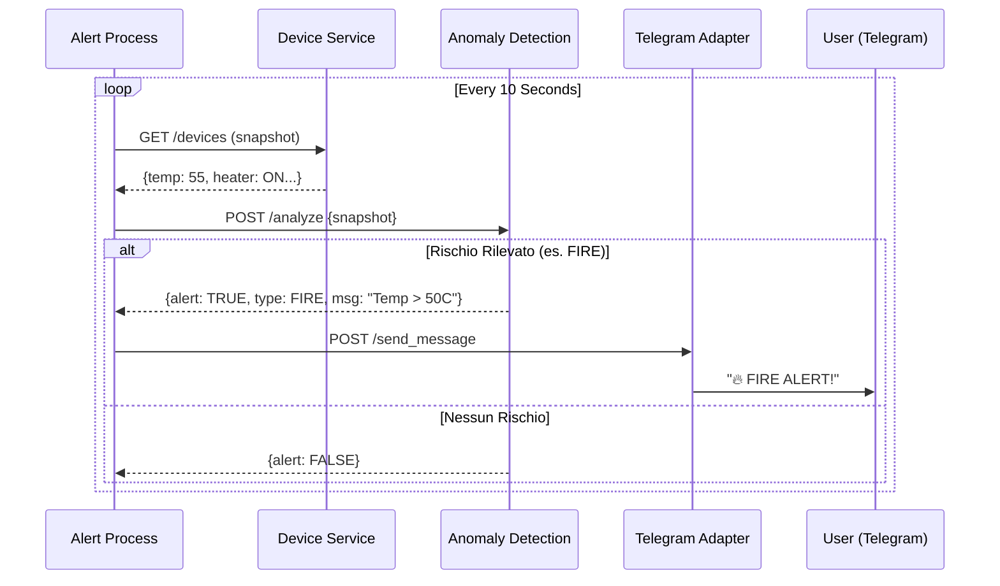
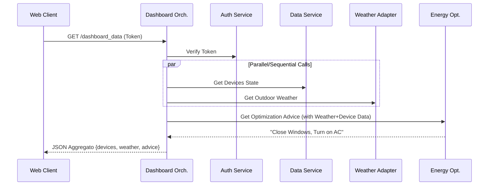

# SmartHome IoT Simulator - Documentazione Architetturale e Logica di Business

## 1. Visione e Obiettivo

Il progetto **SmartHome IoT Simulator** è un sistema **Service-Oriented (SOA)** progettato per la gestione intelligente dell’ambiente domestico. Risolve due problemi chiave:

1.  **Efficienza Energetica**: Ottimizzazione dei consumi basata su temperatura interna, esterna (meteo reale) e stato dei dispositivi.
2.  **Sicurezza Domestica**: Monitoraggio continuo per rilevare anomalie (incendio, conflitti energetici, sprechi) e notificare l’utente su Telegram.

L'applicazione simula un ecosistema IoT completo, orchestrato per fornire valore tramite una Dashboard Web e notifiche push.

---

## 2. Architettura del Sistema

L'architettura segue rigorosamente il **Layered Architectural Pattern**, garantendo disaccoppiamento, manutenibilità e scalabilità. I servizi comunicano via **HTTP/REST** scambiando messaggi **JSON**.

### Diagramma Architetturale (Mermaid)

```mermaid
graph TD
    subgraph "User Interface Layer"
        UI[Web Dashboard (Flask)]
        TG[Telegram Client]
    end

    subgraph "Process Centric Layer (Orchestration)"
        DO[Dashboard Orchestrator :5004]
        AP[Alert Process :5007]
    end

    subgraph "Business Logic Layer (Intelligence)"
        EO[Energy Optimization Service :5006]
        AD[Anomaly Detection Service :5003]
        AS[Auth Service :5010]
    end

    subgraph "Adapter Services Layer (Integration)"
        WA[Weather Adapter :5002]
        TA[Telegram Adapter :5005]
    end

    subgraph "Data Services Layer (Persistence)"
        DS[Device Data Service :5001]
        DB[(MongoDB)]
    end

    %% Data Flow
    UI -- "HTTP GET /dashboard" --> DO
    TG <-- "Webhook/Polling" --> TA
    
    DO -- "GET /devices" --> DS
    DO -- "GET /weather" --> WA
    DO -- "POST /optimize" --> EO
    DO -- "POST /verify" --> AS
    
    AP -- "GET /devices" --> DS
    AP -- "POST /analyze" --> AD
    AP -- "POST /send_message" --> TA
    
    EO -- "GET /weather" --> WA
    AD -- "GET /devices" --> DS
    
    DS -- "pymongo" --> DB
```

### Tabella dei Microservizi

| Servizio | Porta | Livello | Responsabilità Principale | Dipendenze |
| :--- | :--- | :--- | :--- | :--- |
| **Device Data Service** | `5001` | Data | CRUD sui dispositivi, Persistenza stato/storico | MongoDB |
| **Weather Adapter** | `5002` | Adapter | Proxy verso OpenWeatherMap API | OpenWeatherMap API |
| **Anomaly Detection** | `5003` | Business Logic | Analisi rischi e conflitti (Regole di Business) | Nessuna (Input via HTTP) |
| **Dashboard Process** | `5004` | Process | Aggregazione dati per UI (Gateway) | Data, Weather, Auth, Energy |
| **Telegram Adapter** | `5005` | Adapter | Interfaccia verso Telegram Bot API | Telegram API |
| **Energy Optimizer** | `5006` | Business Logic | Algoritmi di risparmio energetico | Weather Adapter |
| **Alert Process** | `5007` | Process | Loop asincrono di monitoraggio e allerta | Data, Anomaly, Telegram |
| **Auth Service** | `5010` | Business Logic | Gestione Utenti, JWT Token, Login/Register | MongoDB |
| **Web App** | `5008`* | UI | Interfaccia Utente (Frontend) | Dashboard Process |

*\*La Web App è servita separatamente o integrata, qui indicata logicamente.*

---

## 3. Dettaglio dei Livelli e Logica di Business

### A. Data Services Layer (Persistenza)
**Device Data Service** (`5001`) è l'unico proprietario del database.
- **Isolamento**: Nessun altro servizio accede al DB direttamente (eccetto Auth per gli utenti).
- **Funzionalità**: Gestisce lo stato dei sensori (Temperature) e attuatori (Lights, Heater, AC, Windows).

### B. Adapter Services Layer (Integrazione)
Isola il core del sistema dalle API esterne. Se le API esterne cambiano, si modifica solo l'adapter.
1.  **Weather Adapter Service** (`5002`): Normalizza i dati meteo (converte Kelvin->Celsius, standardizza i campi).
2.  **Telegram Adapter Service** (`5005`): Gestisce l'invio fisico dei messaggi.

### C. Business Logic Services Layer (Intelligenza)
Contiene la "Logica Pura". Non si preoccupa di UI o DB, ma solo di regole.

#### 1. Energy Optimization Service (`5006`)
Decide la strategia migliore per il comfort e il risparmio.
- **Input**: Temperatura Interna, Temperatura Esterna/Meteo.
- **Logica**:
    - **Estate**: Se $T_{in} > T_{out}$, consiglia "Free Cooling" (Apri Finestre) invece di accendere l'AC.
    - **Inverno**: Se $T_{in}$ è alta ma il riscaldamento è acceso, consiglia di spegnere per inerzia termica.
    - **Mezza Stagione**: Logica ibrida basata su soglie di comfort (20-24°C).

#### 2. Anomaly Detection Service (`5003`)
Il cuore della sicurezza. Analizza snapshot dello stato casa.
- **Regole**:
    1.  **FIRE RISK**: Se `Temperature > 50°C`. Priorità: CRITICAL.
    2.  **HIGH TEMP**: Se `Temperature > 28°C`. Priorità: WARNING.
    3.  **CRITICAL CONFLICT**: Se `Heater == ON` **E** `AC == ON`. (Spreco assurdo).
    4.  **ENERGY WASTE**: Se `Window == OPEN` **E** (`Heater == ON` **O** `AC == ON`).

#### 3. Auth Service (`5010`)
Gestisce la sicurezza degli accessi. Implementa standard **JWT (JSON Web Tokens)**.

### D. Process Centric Layer (Orchestrazione)
Coordina i servizi per eseguire processi aziendali complessi.

#### 1. Dashboard Process (`5004`)
Pattern **API Gateway / Aggregator**. La UI fa **una sola chiamata** a questo servizio, che ne fa 4 in parallelo (o sequenza) e impacchetta il risultato.
- **Vantaggio**: Riduce la latenza percepita e la complessità del client.

#### 2. Alert Process (`5007`)
Processo Background Asincrono.
- Esegue un ciclo infinito (ogni 5-10 secondi).
- **Flow**:
    1.  Fetch stato dispositivi (`Data Service`).
    2.  Push stato a `Anomaly Service` per analisi.
    3.  Se `Anomaly Service` ritorna un'anomalia -> Chiama `Telegram Adapter`.

---

## 4. Diagrammi di Sequenza

### Flusso di Monitoraggio Anomalie (Loop)



### Flusso Caricamento Dashboard



---

## 5. Modelli Dati (Schema Essenziale)

### Device Document (MongoDB)
```json
{
  "device_id": "living_room_temp",
  "type": "sensor",
  "value": 24.5,
  "unit": "C",
  "last_updated": "2023-10-27T10:00:00"
}
```

### Anomaly Response
```json
{
  "has_anomaly": true,
  "anomalies": [
    {
      "type": "ENERGY_WASTE",
      "severity": "medium",
      "message": "Window is OPEN while AC is ON"
    }
  ]
}
```
