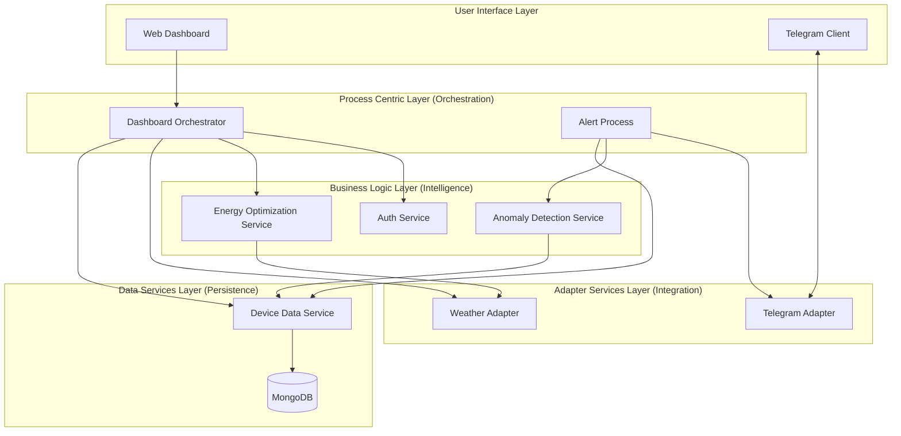

# SmartHome IoT Simulator - Documentazione Architetturale e Logica di Business

## 1. Visione e Obiettivo

Il progetto **SmartHome IoT Simulator** è un sistema Service-Oriented (SOA) progettato per la gestione intelligente dell’ambiente domestico. Risolve due problemi chiave:

1.  **Efficienza Energetica**: Ottimizzazione dei consumi basata su temperatura interna, esterna (meteo reale) e stato dei dispositivi.
2.  **Sicurezza Domestica**: Monitoraggio continuo per rilevare anomalie (incendio, conflitti energetici, sprechi) e notificare l’utente su Telegram.

L'applicazione simula un ecosistema IoT completo, orchestrato per fornire valore tramite una Dashboard Web e notifiche push.

---

## 2. Architettura del Sistema

L'architettura segue il **Layered Architectural Pattern**, garantendo disaccoppiamento e manutenibilità. I servizi comunicano via HTTP/REST scambiando JSON.

### Diagramma Logico

---

## 3. Dettaglio dei Livelli e Logica di Business

### A. Data Services Layer (Persistenza)
**Device Data Service** (`5001`)
*   **Ruolo**: Unico punto di accesso al DB. Gestisce sensori e attuatori.
*   **Interfaccia**: REST CRUD (`GET /devices`, `POST /readings`).

### B. Adapter Services Layer (Integrazione)
1.  **Weather Adapter Service** (`5002`)
    *   **Ruolo**: Fornisce meteo reale (API esterna) normalizzato.
2.  **Telegram Adapter Service** (`5005`)
    *   **Ruolo**: Invia messaggi al Bot Telegram dell'utente.

### C. Business Logic Services Layer (Intelligenza)
Questo livello contiene le regole di dominio pure.

#### 1. Energy Optimization Service (`5006`)
Calcola consigli basati sulla stagione e temperature.
*   **Logica Stagionale**:
    *   **Estate**: Priorità al raffrescamento naturale. Se `T_in > T_out` consiglia "Apri finestre" invece di AC.
    *   **Inverno**: Priorità al risparmio riscaldamento. Se `T_in` alta, consiglia "Spegni caldaia".
    *   **Mezza Stagione**: Bilanciamento ibrido.
    *   **Auto**: Deduce la stagione dalla temperatura esterna.

#### 2. Anomaly Detection Service (`5003`)
Analizza i dati per identificare situazioni critiche.
*   **Regole di Business**:
    1.  **Rischio Incendio**: Se `Temp > 50°C` -> Allarme "FIRE RISK".
    2.  **Temperatura Alta**: Se `Temp > 28°C` (e < 50) -> Allarme "HIGH TEMP".
    3.  **Conflict Detection**: Se `Air Conditioner == ON` AND `Heater == ON` -> Allarme "CRITICAL CONFLICT".
    4.  **Energy Waste**: Se `Window == OPEN` AND (`Heater == ON` OR `AC == ON`) -> Allarme "ENERGY WASTE".

### D. Process Centric Layer (Orchestrazione)
Coordina i servizi sottostanti.

#### 1. Dashboard Process (`5004`)
Aggrega dati per la UI in una singola chiamata.
*   **Orchestrazione (4 Servizi)**:
    1.  Chiama **Data Service** (Letture sensori).
    2.  Chiama **Weather Adapter** (Meteo corrente).
    3.  Chiama **Auth Service** (Verifica token).
    4.  Chiama **Energy Optimizer** (Richiede strategia).
*   **Output**: JSON completo per la Web App.

#### 2. Alert Process (`Background Loop`)
Monitoraggio continuo e proattivo.
*   **Orchestrazione (3 Servizi)**:
    1.  **Data Service**: Scarica lo stato di tutti i dispositivi.
    2.  **Anomaly Detection**: Invia i dati per l'analisi rischi.
    3.  **Telegram Adapter**: Se rilevata anomalia (o cambio stato), invia notifica.

### E. UI Layer
*   **Web App**: Interfaccia grafica Flask per visualizzare dashboard e controllare dispositivi.
*   **Telegram Bot**: Canale di notifica push per allarmi critici.

---

## 4. Scenari di Business (Esempi)

### Scenario 1: Prevenzione Incendio
1.  Sensore rileva `55°C`.
2.  **Alert Process** invia dato a **Anomaly Service**.
3.  **Anomaly Service** rileva `> 50°C` e ritorna `type: FIRE`.
4.  **Alert Process** chiama **Telegram Adapter**.
5.  Utente riceve: "🔥 CRITICAL: High Temperature detected: 55.0 C (Fire Risk!)".

### Scenario 2: Spreco Energetico (Finestra Aperta)
1.  Utente accende il condizionatore (`AC=ON`) ma lascia la finestra aperta (`Window=OPEN`).
2.  **Alert Process** invia stato a **Anomaly Service**.
3.  **Anomaly Service** incrocia gli stati: `Window=OPEN` + `AC=ON`.
4.  Ritorna `type: WASTE`.
5.  **Alert Process** notifica: "⚠️ ENERGY WASTE: Air Conditioner is ON while Living Room Window is OPEN!".

### Scenario 3: Conflitto Dispositivi
1.  Utente accende Riscaldamento e Aria Condizionata insieme.
2.  **Anomaly Service** rileva `Heater=ON` AND `AC=ON`.
3.  Notifica immediata: "CRITICAL ENERGY WASTE: Conflict detected!".
